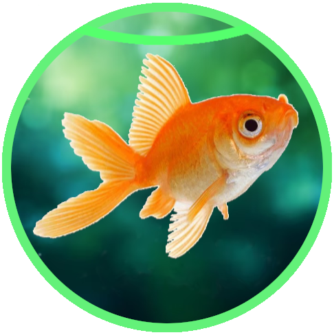

  

<h1 align="center">Vezu</h1>

  Visualizador e editor básico de imagens para Windows 10 e 11, com foco em <b>impressão rápida e eficiente</b>.

  

---

## Sobre o Projeto

O **Vezu** nasceu para resolver um problema simples: visualizar e fazer edições básicas em imagens de forma rápida, especialmente quando o objetivo final é a impressão.

Visualização rápida de imagens. 
Edições básicas (cortar, girar, ajustar). 
Otimizado para funções extras de impressão. 
Criação de cartazes montáveis usando a Função de Mosaico.

## ❤️ Apoie o Projeto

O Vezu é um projeto gratuito e de código aberto. Se ele for útil para você, considere fazer uma doação de qualquer valor para apoiar o desenvolvimento!

  
Escaneie o QR Code abaixo com o app do seu banco:

  
  <!-- Aqui está a chamada para a imagem que você acabou de subir -->
  
  
    
  
  
Ou se preferir, use a chave PIX aleatória (Copie e Cole):

  <code>b90456bb-ca54-4753-a307-a043b0a2cea4</code>

